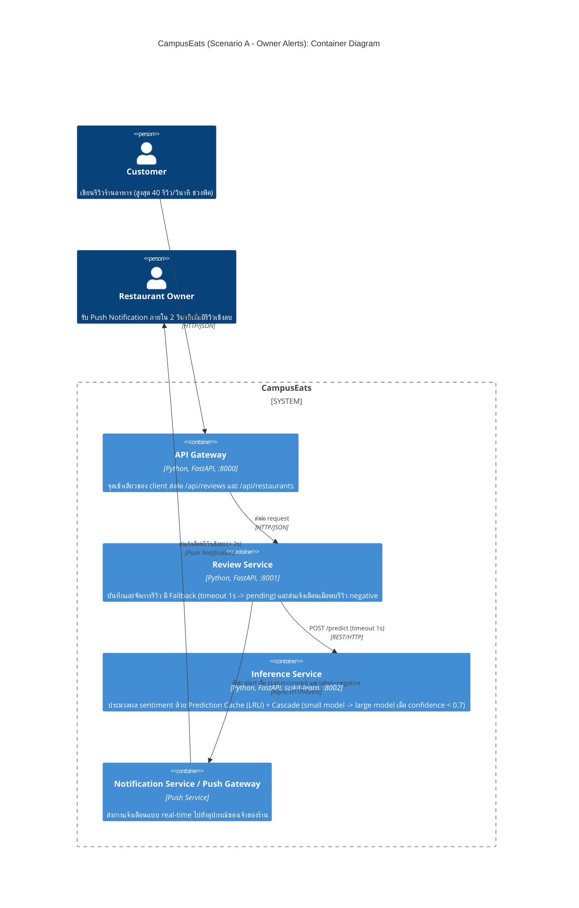

# Task 4: Deployment topologies and trade-offs

**Name / ชื่อ:** กฤตานน ยวงทอง

**Student ID / รหัสนิสิต:** 6970008621

This is **individual work**: each student completes and submits their own copy, in their own fork.

*งานนี้เป็น**งานเดี่ยว** นิสิตแต่ละคนทำและส่งงานของตัวเอง ใน fork ของตัวเอง*

**Scenario (A, B or C) / Scenario ที่เลือก:** A (Owner alerts)

Choose **one** scenario below. If the last digit of your student ID is odd, take A or B; if it is even, take B or C. Use your measurements from Tutorial 6 as evidence: cite run names from `results/runs.csv`. Answer in Thai or English.

เลือก scenario **หนึ่ง** ข้อด้านล่าง ถ้าเลขตัวสุดท้ายของรหัสนิสิตเป็นเลขคี่ ให้เลือก A หรือ B ถ้าเป็นเลขคู่ ให้เลือก B หรือ C ใช้ผลการวัดจาก tutorial ที่ทำไปเป็นข้อมูลอ้างอิง โดยอ้างชื่อ run จาก `results/runs.csv` จะตอบเป็นภาษาไทยหรือภาษาอังกฤษก็ได้

Facts that hold in every scenario / ข้อเท็จจริงที่ใช้กับทุก scenario:

- The large model serves at most **20 calls per second** (4 calls at once × about 200 ms each), and every call costs money.

  *large model รับได้สูงสุด **20 calls ต่อวินาที** (พร้อมกัน 4 calls × ประมาณ 200 ms ต่อ call) และทุก call มีค่าใช้จ่าย*
- The small model is fast and cheap enough to run anywhere, including inside the review service or on a kiosk, but it is much less accurate on its own.

  *small model เร็วและถูกพอที่จะรันที่ไหนก็ได้ รวมถึงภายใน review service หรือบน kiosk แต่ถ้าใช้ตัวเดียวจะแม่นน้อยกว่ามาก*

## Scenarios

**A. Owner alerts.** When a customer posts a negative review, the restaurant owner gets a push notification within **2 seconds**. At the lunch peak, CampusEats receives **40 reviews per second**. A missed alert is acceptable, but a wrong alert (for example, "your customer is unhappy" when they are happy) makes owners stop trusting alerts and, in the end, ignore them.

*เมื่อลูกค้าโพสต์รีวิวเชิงลบ เจ้าของร้านจะต้องได้รับ push notification ภายใน **2 วินาที** เวลาช่วงพีคตอนเที่ยง CampusEats ได้รับรีวิวจำนวน **40 รายการต่อวินาที** การพลาด alert ไปบ้างนั้นยอมรับได้ แต่ alert ที่ผิด (เช่น "ลูกค้าไม่พอใจ" ทั้งที่จริงๆ แล้วพอใจ) จะทำให้เจ้าของร้านไม่เชื่อถือและเลิกสนใจ alert ในที่สุด*

**B. Canteen kiosk.** A tablet in each canteen lets students leave a review on the spot. However, the canteen Wi-Fi is poor: the tablets lose their connection several times a day, for minutes at a time. The system must accept every review, even while a tablet is offline. Restaurant owners need the labels **by the end of the day**.

*มี tablet ในแต่ละโรงอาหารให้นิสิตรีวิวได้ทันที อย่างไรก็ดี การเชื่อมต่อ Wi-Fi ในโรงอาหารไม่ดี ทำให้ tablet หลุดการเชื่อมต่อวันละหลายครั้ง ครั้งละหลายนาที ระบบจะต้องรับรีวิวได้ทุกรายการแม้ขณะที่กำลัง offline อยู่ และเจ้าของร้านต้องการ label **ภายในสิ้นวัน***

**C. Weekly report.** Restaurant owners want a weekly sentiment report. Nothing in producing this report has to be real-time. **Accuracy matters most** and **cost must be minimal**.

*เจ้าของร้านต้องการรายงาน sentiment รายสัปดาห์ ไม่มีอะไรที่จะต้องทำแบบ real-time ในการออกรายงานนี้ ความแม่นยำ **(accuracy) สำคัญที่สุด** และ **ค่าใช้จ่ายต้องน้อยที่สุด***

## Topologies and patterns to choose from / Topology และ pattern ที่เลือกใช้ได้

| | Topology | Where the model runs / โมเดลรันที่ไหน |
|---|---|---|
| T1 | Model as a service, synchronous | Inference service, called for each review (today's baseline) *inference service ถูกเรียกทุกรีวิว (baseline ของวันนี้)* |
| T2 | Model as a library | Inside the review service, or on the device *ภายใน review service หรือบนอุปกรณ์* |
| T3 | Hybrid | Small model locally, large model as a remote service *small model รันในเครื่อง large model เป็น remote service* |
| T4 | Asynchronous / batch | Reviews are queued (broker, W10) or stored, and scored later in bulk *รีวิวถูกเข้าคิว (broker, W10) หรือเก็บไว้ แล้วติด label ทีหลังเป็นชุด* |

Combine one topology with any of the patterns from Tutorial 6: **fallback**, **cascade** and **cache**.

*เลือก topology หนึ่งแบบ แล้วผสมกับ pattern จาก Tutorial 6 ได้ตามต้องการ: **fallback**, **cascade** และ **cache***

## 1. Quality requirements

The three most important quality requirements for your scenario, each with a number where possible.

*quality requirements ที่สำคัญที่สุด 3 ข้อของ scenario ที่เลือก ระบุตัวเลขเมื่อทำได้*

| # | Quality | Requirement |
|---|---|---|
| 1 | Performance (Latency) | เมื่อมีรีวิวเชิงลบ เจ้าของร้านต้องได้รับ push notification ภายใน **2 วินาที** (เวลาประมวลผลรีวิว `p95 ≤ 1000 ms` และรวมการส่งแจ้งเตือนไม่เกิน 2,000 ms) |
| 2 | Capacity & Scalability (Throughput) | รองรับปริมาณรีวิวช่วงพีคตอนเที่ยงที่ **40 รีวิวต่อวินาที** โดยส่ง request ไปถึง large model ไม่เกินขีดจำกัดสูงสุด **20 calls ต่อวินาที** (`large_calls ≤ 50%`) |
| 3 | Accuracy & Availability | ความแม่นยำของ sentiment label ต้องไม่ต่ำกว่า **90%** (เช่น **93.0%**) เพื่อป้องกันการแจ้งเตือนผิดพลาด (false alerts) และหากโมเดลค้างต้องตัดจบภายใน **1 วินาที** (`errors = 0`) โดยยอมให้รีวิวที่ค้างเป็น `pending` (ยอมพลาดแจ้งเตือนบางรายการได้ดีกว่าแจ้งเตือนมั่วหรือระบบล่ม) |

## 2. Design / การออกแบบ

Your topology, the patterns you add, and a container-level diagram (C4 level 2). The C4 diagram must be written in Mermaid.

*topology ที่เลือก pattern ที่เพิ่ม และ diagram ระดับ container (C4 level 2) เขียนด้วย Mermaid*

* **Topology ที่เลือก:** **T1 (Model as a service, synchronous)** (หรือมองเป็น **T3 Hybrid** ภายในระบบที่คัดกรองด้วย small model ก่อนเรียก large model แบบ synchronous) เพื่อให้รู้ผล sentiment ทันทีในจังหวะที่ลูกค้าโพสต์รีวิวและส่งแจ้งเตือนภายใน 2 วินาที
* **Patterns ที่ใช้ร่วมกัน:** **Prediction Cache + Cascade (`threshold = 0.7`) + Fallback (`timeout = 1s`)**
  1. **Cache:** ดักจับข้อความรีวิวที่ซ้ำกันใน `Inference service` เพื่อตอบกลับทันทีโดยไม่ต้องรันโมเดลซ้ำ
  2. **Cascade (`threshold = 0.7`):** รัน `small model` ก่อน ถ้ารีวิวชัดเจน (`confidence ≥ 0.7`) ให้ใช้ผลทันที ถ้าน้อยกว่าจึงส่งต่อไปยัง `large model` ช่วยลดภาระของ `large model` ให้อยู่ภายใต้ขีดจำกัด 20 calls/s
  3. **Fallback (`timeout = 1s`):** ที่ `Review service` กำหนดเวลาคอยผลจาก `Inference service` ไม่เกิน 1 วินาที หาก `large model` ค้างหรือโหลดเกิน ให้บันทึกรีวิวเป็น `pending` ทันที (ไม่ส่ง alert ที่ไม่ชัวร์ และสามารถให้ background batch job มาประมวลผลย้อนหลังได้)

## 3. Evidence / หลักฐาน

Which runs support your choice? Show the numbers and, for scenario A, the capacity arithmetic: how many large-model calls per second does your design need at the peak?

*run ไหนที่สนับสนุนการตัดสินใจของนิสิต ให้นิสิตแสดงตัวเลขประกอบ และสำหรับ scenario A ให้นิสิตแสดงการคำนวณ capacity ด้วย เพื่อแสดงว่าในช่วงพีคนั้น design ของนิสิตต้องใช้ large model กี่ calls ต่อวินาที*

| Run | What it shows / แสดงอะไร |
|---|---|
| `t0-large` | ใช้ large model 100% ได้ `accuracy = 93.5%`, `p50 = 498 ms`, `p95 = 595 ms` แต่ที่โหลดพีค 40 รีวิว/วินาที จะต้องเรียก large model ถึง **40 calls/s** ซึ่งเกินขีดจำกัดสูงสุดของระบบ (รับได้แค่ 20 calls/s) |
| `t0-small` | ใช้ small model อย่างเดียวเร็วมาก (`p50 = 13 ms`, `p95 = 28 ms`, `large_calls = 0%`) แต่ได้ `accuracy` เพียง **72.5%** ซึ่งต่ำเกินไปและจะทำให้เกิดการแจ้งเตือนผิดพลาด (false alerts) จนเจ้าของร้านเลิกเชื่อถือ |
| `t2-0.7` | การใช้ Cascade ที่ `threshold = 0.7` รักษา `accuracy` ได้ถึง **93.0%** (`p50 = 365 ms`, `p95 = 582 ms`) และลด `large_calls` ลงเหลือ **53%** แต่ที่โหลด 40 รีวิว/วินาที ยังคงใช้ `40 × 53% = 21.2 calls/s` ซึ่งยังเกินเพดาน 20 calls/s อยู่เล็กน้อย |
| `t3-cache` | เมื่อเปิด **Cache ร่วมกับ Cascade (`threshold = 0.7`)** ได้ `cache_hits = 35%` ช่วยลด `large_calls` ลงเหลือเพียง **38%** โดยที่ `accuracy` ยังสูงถึง **93.0%** และเร็วขึ้นมาก (`p50 = 7 ms`, `p95 = 571 ms` ซึ่งต่ำกว่าเกณฑ์ 2 วินาทีมาก) |
| `t1-before` & `t1-after` | เมื่อโมเดลค้าง 10% การไม่มี fallback (`t1-before`) ทำให้เกิด `errors = 20` และรันนาน `26.5 s` แต่เมื่อใส่ **Fallback timeout 1s (`t1-after`)** จะได้ `errors = 0`, `p95 = 1008 ms` และเปลี่ยนรีวิวที่ค้าง 22 รายการเป็น `pending` แทน (ยอมพลาด alert บางรายการดีกว่าปล่อยให้ระบบค้าง) |

**การคำนวณ Capacity ช่วงพีค (Capacity Arithmetic สำหรับ Scenario A):**
- ปริมาณรีวิวช่วงพีคตอนเที่ยง = **40 รีวิว/วินาที**
- ขีดจำกัดสูงสุดของ `large model` = **20 calls/วินาที** (พร้อมกัน 4 calls × ~200 ms ต่อ call)
- หากใช้ Baseline (`t0-large`, `large_calls = 100%`): $\text{40 รีวิว/วินาที} \times 100\% = \text{40 calls/วินาที}$ (**เกินความจุ 2 เท่า** ระบบจะคิวล้นและ timeout)
- หากใช้เฉพาะ Cascade (`t2-0.7`, `large_calls = 53%`): $\text{40 รีวิว/วินาที} \times 53\% = \text{21.2 calls/วินาที}$ (**ยังเกินขีดจำกัด 20 calls/วินาที**)
- หากใช้ **Design ที่เลือก (`t3-cache`: Cascade 0.7 + Cache, `large_calls = 38%`)**:
  $$\text{Large-model calls at peak} = 40 \text{ reviews/s} \times 38\% = \mathbf{15.2 \text{ calls/s}}$$
  ซึ่ง **ต่ำกว่าขีดจำกัด 20 calls/วินาที อย่างปลอดภัย** (ยังมี headroom เหลืออีก ~24%) และใช้เวลา `p95 = 571 ms` จึงส่งแจ้งเตือนถึงเจ้าของร้านได้ทันภายใน 2 วินาทีอย่างแน่นอน

## 4. ADR

Use the ADR format from W5.

*ใช้รูปแบบ ADR จาก W5*

**Title:** ADR: การเลือกใช้สถาปัตยกรรม Synchronous Model-as-a-Service ร่วมกับ Cascade, Prediction Cache และ Fallback สำหรับระบบแจ้งเตือนรีวิวเชิงลบแบบ Real-time (Scenario A)

**Status:** Proposed

**Context:**
ระบบ CampusEats ต้องการส่ง Push Notification แจ้งเตือนเจ้าของร้านภายใน **2 วินาที** เมื่อลูกค้าโพสต์รีวิวเชิงลบ โดยในช่วงพีคตอนเที่ยงมีรีวิวเข้ามาสูงถึง **40 รีวิวต่อวินาที** ข้อจำกัดสำคัญคือ `large model` มีความแม่นยำสูง (`93.5%` ใน `t0-large`) แต่มีค่าใช้จ่ายต่อการเรียกและรับโหลดได้สูงสุดเพียง **20 calls ต่อวินาที** เท่านั้น ในขณะที่ `small model` เร็วและฟรีแต่มีความแม่นยำต่ำ (`72.5%` ใน `t0-small`) หากใช้เดี่ยวๆ จะทำให้เกิดการแจ้งเตือนที่ผิดพลาด (false alerts) จนเจ้าของร้านหมดความเชื่อถือ ส่วนการพลาดแจ้งเตือนบางรายการสามารถยอมรับได้

**Decision:**
เราตัดสินใจเลือกใช้ **Topology T1 (Model as a service, synchronous)** โดยผสาน 3 รูปแบบการออกแบบ (Design Patterns) เข้าด้วยกัน ได้แก่:
1. **Prediction Cache (LRU, max_size=1000)** ที่ `Inference service` เพื่อตอบกลับข้อความรีวิวที่ซ้ำกันทันที
2. **Cascade (`threshold = 0.7`)** ที่ `Inference service` โดยให้ `small model` ประมวลผลก่อน และส่งต่อไปยัง `large model` เฉพาะเมื่อ `confidence < 0.7`
3. **Fallback (`timeout = 1.0 วินาที`)** ที่ `Review service` เพื่อตัดจบการรอหาก `Inference service` ช้าหรือค้าง แล้วบันทึกรีวิวเป็นสถานะ `pending` แทนการปล่อยให้ล้มเหลว

**Consequences:**
- Positive:
  - **รองรับโหลดช่วงพีค 40 รีวิว/วินาทีได้ภายในขีดจำกัดของ Large Model:** จากผลการวัดใน `t3-cache` การใช้ Cache (`cache_hits = 35%`) ร่วมกับ Cascade (`threshold = 0.7`) ช่วยลดสัดส่วนการเรียก `large model` เหลือเพียง **38%** คิดเป็น **15.2 calls/วินาที** ที่โหลดพีค (ต่ำกว่าเพดาน 20 calls/วินาที) และลดค่าใช้จ่ายลงถึง 62%
  - **ตอบสนองทันภายใน 2 วินาทีด้วยความแม่นยำสูง:** ได้ค่า `p50 = 7 ms` และ `p95 = 571 ms` (เร็วกว่ากำหนด 2 วินาทีมาก) พร้อมรักษาความแม่นยำไว้ที่ **93.0%** ซึ่งลดโอกาสเกิด false alerts
  - **ทนทานต่อความล้มเหลว (Resilience):** จาก `t1-after` เมื่อเกิดอาการค้าง Fallback ขนาด 1 วินาทีช่วยป้องกันไม่ให้เกิด error (`errors = 0`, `p95 = 1008 ms`) และไม่ดึงให้ระบบทั้งระบบค้างตาม
- Negative:
  - **อาจพลาดการแจ้งเตือนในบางกรณี:** รีวิวที่ถูกตัดจบเป็น `pending` จาก Fallback เมื่อโมเดลค้าง หรือรีวิวที่มีรูปแบบประโยคซับซ้อน (เช่น ประโยคปฏิเสธซ้อน) ที่ `small model` มั่นใจผิดพลาดเกิน 0.7 จะไม่ได้ส่งแจ้งเตือนทันที (แต่โจทย์ระบุว่าการพลาดแจ้งเตือนบ้างสามารถยอมรับได้)
  - **ความซับซ้อนในการดูแลรักษาเพิ่มขึ้น:** ต้องจัดการการล้างค่า Cache (cache invalidation) เมื่อมีการอัปเดตโมเดลใหม่ และต้องเฝ้าระวังการปรับค่า threshold ให้เหมาะสมอยู่เสมอ

**Alternatives considered:** at least one topology you rejected, and why.

*อย่างน้อยหนึ่ง topology ที่ไม่เลือก และเหตุผล*

> 1. **T4 (Asynchronous / batch topology):** ไม่เลือกเพราะการนำรีวิวเข้าคิวเพื่อรอประมวลผลเป็นรอบ (batch) ไม่สามารถรับประกันการส่งแจ้งเตือนแบบ real-time ภายใน **2 วินาที** ตามที่ Scenario A กำหนดได้ (เหมาะกับงานที่รอผลสิ้นวันหรืองานรายสัปดาห์อย่าง Scenario B/C มากกว่า)
> 2. **T2 (Model as a library โดยรันเฉพาะ `small model` ใน `Review service`):** ไม่เลือกเพราะแม้จะเร็วมาก (`p95 = 28 ms`) และไม่เสียค่าใช้จ่ายในการเรียก `large model` เลย แต่จากผลการทดลอง `t0-small` พบว่ามีความแม่นยำเพียง **72.5%** (ผิดเกณฑ์ QR3 ที่ต้อง ≥ 90%) ซึ่งจะส่งผลให้เกิดการแจ้งเตือนผิดพลาดจำนวนมากจนเจ้าของร้านเลิกเชื่อถือระบบ
> 3. **T1 (Synchronous โดยเรียก `large model` ตรงๆ ทุกครั้ง หรือใช้ Cascade โดยไม่เปิด Cache):** ไม่เลือกเพราะจาก `t0-large` (`large_calls = 100%` -> 40 calls/s) และ `t2-0.7` (`large_calls = 53%` -> 21.2 calls/s) ทั้งคู่ต้องการจำนวนครั้งการเรียก `large model` เกินขีดจำกัดสูงสุด 20 calls/วินาที ในช่วงพีคตอนเที่ยง ซึ่งจะทำให้คิวสะสมจนเกิด timeout ทั้งระบบ
